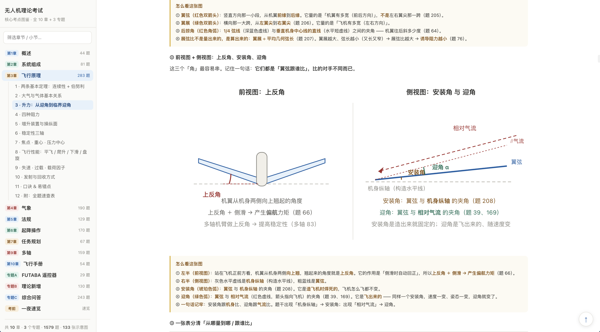
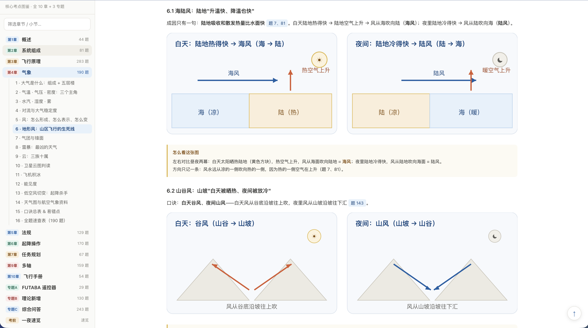
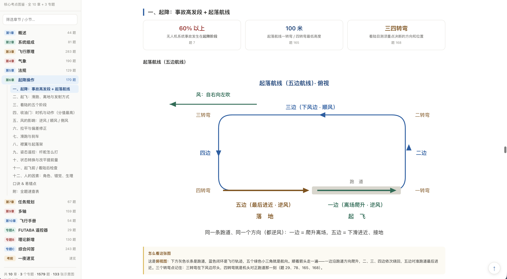
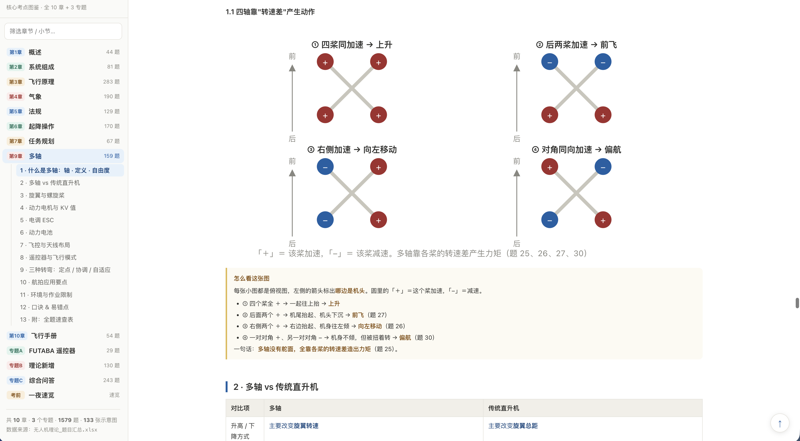

# 无人机理论考试 · 核心考点图鉴

把 CAAC 无人机驾驶员理论考试的 **1579 道选择题**，重新组织成一份**可以当书看的单文件 HTML 图鉴**。

不是题库的另一种排版，而是**按考点重新画过一遍**：每个考点一张手绘 SVG 示意图、一张对照表、一句口诀、一句易错点，章末再附全题速查表。

> **10 章 · 3 个专题 · 1 个考前收口章 ｜ 1579 题 ｜ 166 张示意图 ｜ 183 张表 ｜ 143 个小节**
> 单文件、零依赖 —— 双击即开，不用联网、不用装任何东西。

---

## 效果预览

下面都是这份 HTML 的**实际截图**（未做任何美化）。左边是导航，右边是正文 —— 可以看到每张示意图后面都跟着一段「**怎么看这张图**」的白话导读。

  
  

  
  

- **① 飞行原理 §3 · 升力**（左上）—— **上反角 / 安装角 / 迎角**三个最容易混的角，前视图＋侧视图一次分清：安装角出厂就定死，迎角随速度变
- **② 气象 §6 · 地形风**（右上）—— **海陆风 / 山谷风**的白天与夜间对照。左右两卡只有冷热源换了个位置，风向就跟着反过来
- **③ 起降操作 §一 · 起落航线**（左下）—— 俯视图画清**五边航线**：一边起飞、五边落地，同一条跑道同一个方向；顶部三张数字卡钉死最高频的三个数
- **④ 多轴 §1.1 · 转速差**（右下）—— 四轴**怎么动**：四种状态 2×2 对照，`+` 加速 `−` 减速，看哪两个桨在变就知道往哪飞

---

## 一、大纲

### 主体十章

| # | 部分 | 题数 | 主要内容 |
|---|---|---|---|
| 1 | **概述** | 44 | 身份与定义（谁是"机长"）、重量级别 Ⅰ–Ⅻ（最高频）、法规四分类、活动半径与任务高度五档、训练时间 |
| 2 | **系统组成** | 81 | 五大分系统、导航飞控、地面站三类站的分工、数据链与三个频段、动力系统、电气系统三层关系、舵机与螺旋桨、配平与维护 |
| 3 | **飞行原理** | 283 | 连续性＋伯努利、大气基本关系、升力与临界迎角、四种阻力、增升装置与操纵面、三轴稳定性、焦点/重心/压力中心、飞行性能、失速与过载、发射与回收 |
| 4 | **气象** | 190 | 大气分层、气温气压密度、水汽与雾、对流与稳定度、风的形成与变化、地形风、气团与锋面、雷暴、云三族十属、卫星云图、飞机积冰、能见度、低空风切变、天气图 |
| 5 | **法规** | 129 | 法规三层级、空域三种切法、飞行管制、分类与管理分工、证照与单飞、飞行计划与时间定义、高度层与灯光避让、适航三证、电子围栏、作业天气标准、违章处罚四档 |
| 6 | **起降操作** | 170 | 起落航线、起飞与发射方式、着陆五阶段、收油门时机与动作、风的影响、拉平与偏差修正、滑跑与刹车、襟翼与起落架、姿态遥控、人的因素 |
| 7 | **任务规划** | 67 | 四种导航＋惯导、任务规划定义与目标、四类约束、预先规划 vs 实时规划、规划流程、航迹规划与优化、电子地图与图元标注、地面站、应急与链路故障 |
| 9 | **多轴** | 159 | 轴与自由度、多轴 vs 传统直升机、旋翼与螺旋桨、动力电机与 KV、电调 ESC、动力电池、飞控与天线布局、飞行模式、三种转弯、航拍与作业限制 |
| 10 | **飞行手册** | 54 | 检查的三个节点、三份手册的关系、证照与文件管理、检查与维护周期、危机/紧急/应急、飞行的组织与实施、记录保存 |

> 题库原表没有第 8 章，所以章号从 7 直接跳到 9。

### 三个专题

| 专题 | 题数 | 说明 |
|---|---|---|
| **A · FUTABA 遥控器** | 29 | 一套独立的遥控器子体系：三层菜单、调机四步、显示设置、通道调整四件套、失控保护 FAIL SAFE、缩写与频率 |
| **B · 理论新增** | 130 | **对照速查**：130 题里只有 **4 题**是真正的新考点，其余逐题告诉你"这题该回哪一章复习"，不重复劳动 |
| **C · 综合问答** | 243 | 按「**手上的活**」组织，不是按概念：电池计算、电机与电调、螺旋桨、遥控器菜单、数据链与天线、飞控传感器、飞行原理、动力失效与故障处置、燃油机与人因；并附 **§11「和前面各章什么关系：哪些是复习、哪些是新的」** |

### 收口章

| 部分 | 说明 |
|---|---|
| **考前一夜速览** | **不引入新考点**。把全册的必背硬数字（8 张表）、跨章最易混的 16 组判别、4 条公式、口诀总汇、临场三步，压成一份 **90 分钟能过完**的清单。考前一晚只看它。 |

---

## 二、优势

### 1. 为「答题」而写，不为「讲全」而写
每个结论后面都挂着**题库原题号**（如「题 12」），随时可以回原表对答案；**不考的内容明确标"不考"**，避免把复习时间花在不会出的知识点上。

### 2. 每章结构完全统一，复习路径可预期
> **开篇主线 → 概念图 → 对照表 → 口诀 → 易错点 → 全题速查表**

13 个部分一个模子，不用每次重新找"这一章该怎么看"。

### 3. 每张图后面都有「怎么看这张图」的白话导读（129 处）
示意图不是配图，是**主要的讲解载体**。每张图后面紧跟一段白话，说清"先看哪儿、哪两个数互不干扰、这题考的是图里哪一根线"——解决图鉴最容易失败的地方：**图看不懂等于没图**。

### 4. 题库自己矛盾的地方，全部点破
同一件事、两道题、答案不一样的地方**单独列节**，并给一句可操作的应对话术（例如「先看选项再选」「看清问的是"功率"还是"转速"」），而不是偷偷按某一题写。综合问答卷扫出 4 组、理论新增卷扫出 3 组，全部标注。

### 5. 「新增卷」不假装是新考点
**专题B** 直接做**溯源对照表**：130 道"新增题"里 126 道是别章原题重发，只精讲真正新的 4 道，其余逐题指向应回哪一章。**专题C** 同样给出「哪些是复习、哪些是这一卷独有」的对照，并列出真正独有的 7 块考点。

### 6. 易混概念做成「反查表」，按题干关键词一眼定位
凡是被反复考、又容易混的一组（云的三族十属、三种转弯、四种导航、失速与临界迎角……），都做成**题干关键词 → 答案**的反查表或**横向阶梯图**，做题时先认关键词，不必从头推理。

### 7. 每章附全题速查表
每个部分末尾都有一张全题表，**答案列是「字母 ＋ 该选项原文」**，共覆盖 1579 题。既可以正查（这题选什么），也可以反查（这个说法出现在哪几题）。

### 8. 单文件、零依赖、可离线、可打印
- 所有示意图都是**内联 SVG**，矢量不失真，打印和缩放都清晰；
- **没有 CDN、没有外部字体、没有图片文件**，一个 HTML 就是全部；
- 可以离线看、可以丢进任何笔记软件、可以发到手机上。

### 9. 导航为长时间翻阅设计
左侧章号 + 章内小节树，**滚到哪儿左侧高亮到哪儿**；侧栏顶部有**关键词筛选框**（如输入「失速」「空域」「电池」，左侧只留下相关小节），窄屏自动收起。

---

## 三、怎么用

| 场景 | 建议 |
|---|---|
| 第一次系统复习 | 按顺序过每一章的「开篇主线 → 概念图 → 对照表」 |
| 某一章老是错 | 直接跳到该章的「口诀 & 易错点」小节 |
| 想确认某道题 | 章末全题速查表，或直接搜题号 |
| 觉得"这些好像都学过" | 看专题C 的 §11「哪些是复习、哪些是新的」 |
| 考前一晚 | 只看最后一章「考前一夜速览」 |

---

## 四、说明

- **数据来源**：`无人机理论_题目汇总.xlsx`（分章题库，列为 序号 / 题目 / A / B / C / 答案）
- **图为示意画，非比例图**；示意图的作用是讲清关系与判据，不是精确工程图
- 题号即题库原序号；跨章引用写作「第3章 197」，专题引用写作「综 12」「新 12」
- 内容依据题库答案整理，如与原题库答案不一致，**以题库为准**
